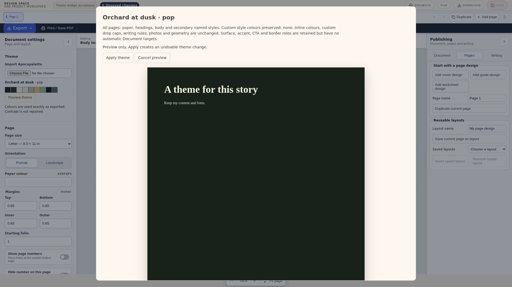

# Apocapalette → Design Space receiving bridge

Source: [v1 contract](https://github.com/maplebakin/palette/blob/main/token-gen/docs/design-space-theme-v1.md), merged [producer PR #31](https://github.com/maplebakin/palette/pull/31) (`46aa5d4525f1b98de870c45396d7ef50ca8a64af`). The receiver validator follows the producer's validating reference API. It never invokes a generator.

## Import and preview

In Document mode, use **Document settings → Theme → Import Apocapalette**. In freeform mode, use **Theme → Import Apocapalette**. Choose the exact `*-designspace-v1.json` file downloaded by the Tasting Room's **Export for Design Space**.

Import validates the entire strict contract before changing anything. The name, mode (including Pop), all nine swatches, and provenance remain intact, including hexadecimal casing. Unknown formats/versions are rejected rather than routed into the legacy importer. Duplicate or low-contrast colours are valid; colours are never repaired. Creator locks/overrides remain provenance and do not replace existing target-object locks. Legacy flat palette exports still load as swatches.

**Preview theme** shows the current Document page through the same read-only renderer used for committed exports, or a separate freeform canvas rendered from the canonical page-space serialization. The modal traps focus, supports Escape, and leaves authored state/history untouched. Entering preview flushes an outstanding text draft, which can create the existing text-edit history entry. Cancel discards the projection. Apply publishes one undoable theme change; a stale preview must be regenerated.

## Document behaviour

- The project paper/background changes on every page.
- Article titles and subsection headings use `heading`; body and quotation styles use `text`; captions and author signatures use `mutedText`. Page numbers use `mutedText`.
- A named style participates when its colour matches its original default, or its role in the previously selected bridge theme. A different custom style colour is preserved and listed in the preview. Older documents with non-default colours can therefore retain more styles. There is no new explicit per-style colour-link/lock UI.
- Fonts, sizes, weights, spacing, inline marks/colours, custom drop caps, writing-rule colours, images, image locks, content and geometry remain unchanged. Inherited drop caps follow their text style.
- `document.bridgeTheme` stores the complete validated source contract as an optional backward-compatible project field. Paper and named styles remain ordinary existing authored state. Project-level Document history, browser-library saves, portable project files, committed PNG/raster-PDF exports and the existing publishing path consume that state.
- `surface`, `accent`, `cta`, `ctaForeground`, and `border` remain available in the saved contract but have no automatic Document targets. Writing rules/dividers retain their authored colours. Existing typography remains the source of truth; this bridge does not introduce cards or buttons into a printable document.

Standard PDF export is raster-backed. The bridge tests check an actual downloaded raster PDF's paper pixel and committed export colour/font projections. They do not establish physical-print colour accuracy, native Tauri/WebKit behaviour, or embedded-font PDF acceptance for every font.

## Freeform behaviour

The active page background and supported linked objects change. Unlinked or unresolved links, colour-locked objects, fully position-locked objects, locked-group descendants and images are skipped. The preview counts these categories and lists up to twelve unthemed object names/IDs. No photo tint/filter or arbitrary colour matching is applied. Other pages are left as authored; there is no new whole-project freeform recolouring action.

All nine roles are available for re-linking through `colors.<role>.value`. Existing `brand`, `typography`, `surfaces`, `borders` and `textPalette` links have explicit aliases in `themeBridge.ts`. Supported border links use the existing stroke-only rule (stroke when an object has stroke and no fill; otherwise fill). Complex mixed-fill/stroke artwork and unsupported legacy token paths can remain unthemed. Inline Fabric text overrides are preserved.

The full contract is retained in the existing `activeTheme` token payload. Theme identity now participates in existing freeform history checkpoints alongside object colours/background, so undo/redo and later object diffs restore it consistently. Library/project reloads retain it. Bridge themes bypass project-to-UI colour synchronization, including on reopen.

## Manual acceptance with a real export

1. In Apocapalette's Tasting Room, name a palette, change/lock several swatches, choose Light, Dark or Pop, then select **Export for Design Space**. Saving the palette first is unnecessary.
2. Create a Document with a title, body, subsection, caption/photo, page numbers and a second page. Set a distinct custom named-style colour and an inline colour. Import the downloaded file and compare all nine swatch tooltips with its JSON.
3. Preview: inspect the current page and preservation report. Cancel and confirm the project keeps its prior theme. Preview again and Apply; check all pages, custom colours, fonts, images and layout. Undo once, then redo.
4. Save, return to Projects, reopen, then download the project JSON. Inspect `document.bridgeTheme`, paper and named styles. Export a standard raster PDF and check its background/text. Use a physical print proof if print colour accuracy matters.
5. In freeform mode, start with linked heading/body/accent/border objects, an unlinked manually coloured shape, a locked shape/group, and a photo. Import the same file; preview the active page and skipped-object report. Apply, undo, redo, save and reopen. Confirm geometry, locks, photo filters and editor chrome stay intact. Use Re-link Object to select any of the nine roles explicitly.
6. Import an older flat Apocapalette JSON to check legacy swatches. Try an unsupported version or a missing role; the selected project theme must remain unchanged.

## Automated checks

- `npm test -- --run`: contract, exact strings, legacy imports, pure preview, preserved overrides/fonts/content, atomic Document rollback, save normalization, export projections, freeform skip policy and history replay.
- `DESIGN_SPACE_E2E_PORT=5188 npx playwright test e2e/theme-bridge.spec.ts e2e/document-typography.spec.ts e2e/document-undo-chronology.spec.ts`: import/preview/cancel/apply, actual rendered colours, undo/redo, library and downloaded JSON persistence, raster PDF paper pixel, linked freeform colours after reopen, unchanged UI colour, invalid input and legacy compatibility, plus existing Document regressions.
- `npm run build`: zero-warning lint, TypeScript and production build.
