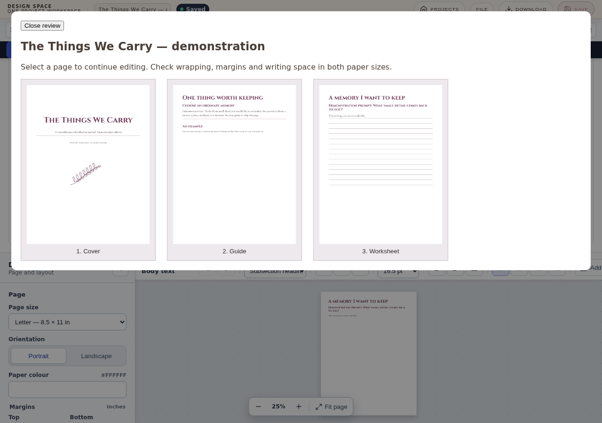

# Printable publishing workflow

Design Space's document editor can now author a cover, guide and ruled worksheet
as ordinary editable content, save them to the library, reuse page designs, and
export Letter/A4 colour or grayscale PDFs. The reference pilot uses clearly
marked demonstration copy; it is not the finished WitchClick journal.

## Journey audit and scope

| Need | Existing implementation | Change in this slice |
| --- | --- | --- |
| Start a multipage printable | Dashboard document creation, Letter/A4/custom sizes | Publishing setup applies paper and margins to every page |
| Consistent typography | Project-wide named styles and inline overrides | Bundled Cinzel and Cormorant Garamond; one document typography action |
| Cover and decorative artwork | Editable title/body stories, imported images, positioned images and numeric geometry | Generic starter cover/guide/worksheet pages; block spacing |
| Writing space | No ruled worksheet element | Editable ruled paragraphs with bounded line count, spacing and colour; editable dividers |
| Reuse pages | Duplicate/reorder/remove already exist | Saved page layouts in IndexedDB, including imported artwork, usable across documents |
| Review | Active-page editing and page tabs | Committed all-page review with navigation back to individual pages |
| Save/reopen | Committed stories, assets, autosave, portable project files and recovery | Extend existing normalization and add real browser persistence/reuse coverage |
| PDF | Ordered 300-DPI raster pages, physical sizes and browser print | Separate embedded-font PDF path and truthful raster labeling; grayscale export |

No product-specific renderer, journal factory or alternate editor is introduced.
Starter designs are ordinary paragraphs, styles and page settings. Illustrations
are imported through the existing image controls and remain independently editable.

## Use the editor

1. On Projects, choose **Create Document Project**. Open **Publishing**.
2. Choose Letter or A4 and margins, then **Apply paper to all pages**. The action
   uses white paper. Existing sidebar controls still provide mirrored inner/outer
   margins and individual page settings.
3. Choose heading/body fonts and an accent, then **Apply document typography**.
   Named styles remain editable in the sidebar. Text overrides remain editable in
   the contextual toolbar.
4. Use **Add cover design**, **Add guide design** and **Add worksheet design**.
   A starter fills a blank current page; otherwise it inserts a new page after it.
   Click and edit all titles, prompts and examples directly on the page.
5. Select a text paragraph and set space before/after to control its vertical
   rhythm. Click inside a writing area, set line count/spacing/colour and choose
   **Update selected writing area**. Insert more ruled areas or dividers at the
   body editor's retained cursor position.
6. Import artwork using **Add photo**. Choose inline/flow or behind/in front of
   text in the image toolbar. Select positioned artwork from the sidebar to edit
   its numeric X/Y and size controls.
7. Duplicate pages using the existing navigator or **Duplicate current design**.
   Rename pages in Publishing. For reuse across documents, enter a layout name and
   choose **Save current page as layout**, then select and **Insert saved layout**.
   Insertion makes a new page; it never replaces current content. The destination
   document's named styles apply. Layouts retain text overrides and embedded art.
8. **Review all pages** shows committed previews. Select a preview to edit that
   page. Save to Library; reopen from Projects. Download a portable project file
   as a separate backup using File.
9. In Export, choose **PDF with embedded fonts** for publishing typography or
   **PDF (raster)** for the existing image-backed output. Grayscale applies to
   downloads and Print / Save PDF without changing authored colours.
10. Switch paper and apply to all pages to prepare the other edition. Review its
    wrapping independently; export before switching again. Exports use reading
    order, not folded-booklet imposition.

## Export contract

The new exporter consumes the existing frozen, committed page renderer. It embeds
static TrueType font faces via pdf-lib/fontkit and emits actual PDF text with
ToUnicode mappings. Browser ranges supply unzoomed glyph positions and canvas
font metrics supply baselines. Publishing surfaces disable ligatures so per-glyph
placement matches the editor. Page furniture and imported images remain 300-DPI
rasters. This is a hybrid PDF with embedded text, not a fully vector document.

The exporter supports the two bundled families at 400/500/600/700, including
Cormorant italics. Cinzel has no italic face. Other fonts, automatic hyphenation,
text transforms, decomposed combining characters, drop caps, clipped/overflowing text and images in front of text
that cover glyphs fail with an actionable message. Print / Save PDF is an explicit
alternative for those layouts; raster PDF remains an explicit alternative too.
No failed embedded-font export is silently converted to raster PDF.

Raster SVG exports embed used publishing font files as data URLs because SVG image
resources cannot load external web fonts. Missing publishing fonts fail rather
than quietly producing a system-font export. Output artwork and text are both
converted when grayscale is selected.

## Persistence and compatibility

The project envelope remains `design-space-project-v2`. Document schema 7 adds
publishing font IDs and bounded paragraph attributes. Existing document schemas
normalize without removing legacy fields. Older clients reject schema 7 rather
than silently dropping its typography/worksheet data. Python and Rust recovery
validators accept schema 7 and retain the authored content.

Dexie schema 8 adds a `documentLayouts` store without rewriting project rows or
canvas templates. A layout stores one normalized page and only its reachable
embedded assets. Missing or externally referenced images must be imported before
saving a layout. Insertion allocates fresh page/image/group identities and remaps
asset collisions. Named document styles belong to the destination project.
Saved layouts are device-local; portable project files remain the backup path.

## Verification and limits

The publishing Playwright scenario authors the three-page pilot through visible
controls, imports an original botanical PNG, edits writing geometry, saves and
inserts a layout, edits the copy independently, removes it, saves/reopens the
journal, reviews it and downloads the portable project and PDFs. PDF assertions
check physical page boxes, actual font streams, ToUnicode, extracted title text
and rendered colour/grayscale pixels. Unit tests cover bounded attributes, HTML
roundtrips, portable reopen, independent duplication and asset collision handling.

The pilot artifact under `artifacts/publishing-pilot/` is produced by that UI test,
not by a journal-generation component. Screenshots/PDF renderings establish browser
output only. Physical printing and native Tauri/WebKitGTK publishing acceptance
require separate proof. Arbitrary uploaded fonts, full vector artwork, automatic
edition packaging, linked master pages and booklet imposition are outside this slice.

## Validation run for this change

- `npm test`: 71 files, 712 tests passed.
- `npm run build`: lint, TypeScript and production build passed. The existing
  bundle-size warning remains.
- Publishing + typography + undo Chromium run: 10 scenarios passed; the
  final publishing rerun also checks explicit unsupported-font failure.
- Required Chromium smoke plus publishing: 7 scenarios passed.
- Existing four-page document save/reopen/raster-export regression: passed.
- `npm run test:recovery`: 3 Python tests passed, including retention of
  publishing fonts and worksheet attributes.
- `cargo test --manifest-path src-tauri/Cargo.toml`: 20 Rust tests passed.
- Final changed-export/editor unit rerun: 85 tests passed.

These runs used the local Node 25 runtime and Chromium. CI continues to cover
Node 20/22, and its required Chromium job now includes the publishing scenario.
No physical print proof or native publishing acceptance is claimed.

